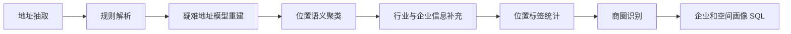

# 地址结构化与商圈画像

从企业地址自由文本中提取行政区划、道路、门牌、实体名称等字段；对难以解析的行进行模型重建，再根据位置语义归并地址并生成商圈与企业画像。

## 文件分类

| 目录 | 内容 | 定位 |
|---|---|---|
| `excel-pipeline/` | 规则解析、异常筛选、LLM 重建、实体相似度、位置打标 | Excel 处理阶段的实现 |
| `database-pipeline/` | 地址抽取、规则预处理、异步重建、位置聚类、行业补充、标签统计、商圈识别 | 数据库处理链路 |
| `sql/` | 企业空间画像、商圈画像、楼宇画像、行业集群画像 | SQL 分析层 |
| `hybrid-parser/` | 规则与模型结合的单脚本实现及既有单元测试 | 独立实现和可本地验证的规则逻辑 |
| [`clustering/`](clustering/README.md) | 地理编码、HDBSCAN、空间近邻与并查集、语义图与 Leiden | 聚类方案对比子模块 |

这些目录是不同实现阶段，不应把它们直接串接成一个统一入口。

## 数据库处理流程

`3.1_company_address_yuexiu_cluster_scope.py` 是聚类后的经营范围补充步骤，按业务需要执行；不要仅按文件名排序理解全部依赖。

## 实现重点

- 规则阶段先做字符和中文数字归一化，再识别字段、合并片段和处理残余文本。
- 筛选阶段保留异常原因，将疑难行交给模型辅助重建。
- 数据库重建阶段包含异步并发、请求重试、进度记录和增量落库。
- 位置聚类阶段综合 core / POI 语义、道路与门牌差异，并使用并查集生成位置标签。
- 已有测试覆盖多房间号保留、市场名称与道路隔离、跨城市行政字段，以及模型补充备注的合并。

## 聚类方案对比

聚类实验已归入本项目的 `clustering/` 子目录，用来比较地理距离与地址语义路线。具体方法、参数假设和内存限制见 [聚类方案对比说明](clustering/README.md)。该子模块的额外依赖保留在 `clustering/requirements.txt`。

## 运行边界

原业务 Excel、企业地址、客户数据、embedding 缓存和模型原始响应均未收录。

文件模式脚本仍需手动准备符合字段要求的 Excel，并修改各脚本顶部的文件与工作表配置。数据库模式仍依赖原表结构、模型输出格式和区域配置。模型名称及请求参数来自原实现，需与你实际部署的服务匹配。

副本中的数据库凭据、模型密钥和服务地址已经外置为环境变量。不同实现原有的 `.env` 读取方式不同，请优先设置进程环境变量，参考仓库根目录 `.env.example`。

本次仅运行无需外部服务的既有测试，未验证数据库链路或在线模型效果。
